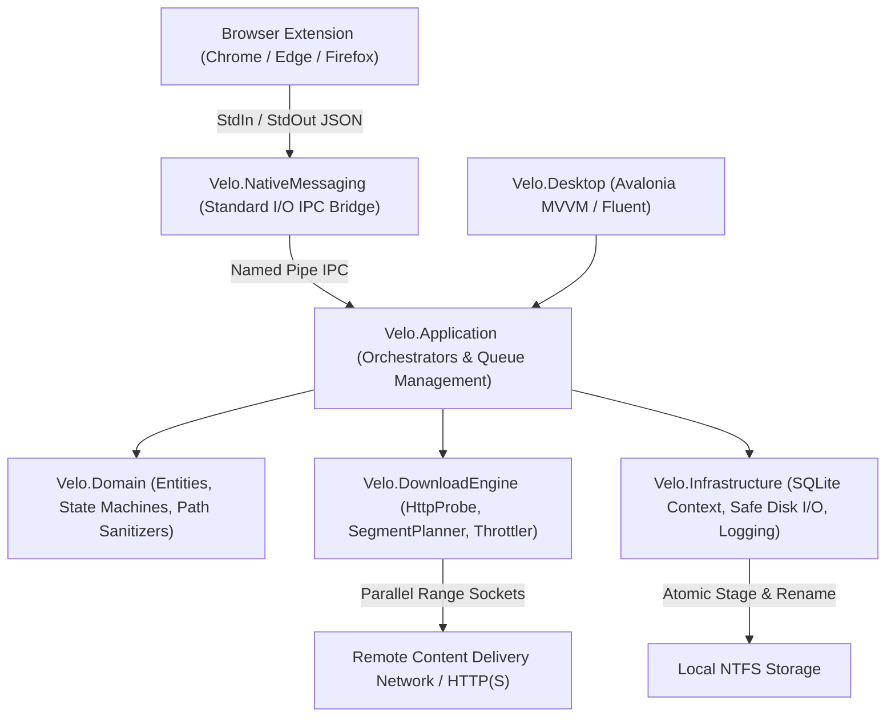

<div align="center">

# VELO
### High-Performance Multi-Stream Download Accelerator
**Native, resilient, zero-telemetry desktop download management engineered for 64-bit Windows environments.**

[](LICENSE)
[](docs/PRD.md)
[](https://learn.microsoft.com/dotnet/)
[](https://avaloniaui.net/)
[](docs/ARCHITECTURE.md)
[](docs/SECURITY.md)

</div>

---

## Executive Overview

**Velo** is an open-source, high-throughput download manager built from the ground up on modern .NET technology and Avalonia UI. Engineered as a clean, performant alternative to legacy proprietary utilities, Velo combines concurrent HTTP range segmenting, transactional crash recovery, granular bandwidth governance, and silent background browser integration into a cohesive, zero-friction desktop experience.

Velo is completely free, ad-free, telemetry-free, and respects user privacy with strict local storage paradigms and defense-in-depth file security.

---

## Key Capabilities

### Core Engine & Throughput
* **Segmented Multi-Connection Streaming:** Dynamically splits downloadable files across up to 16 concurrent socket connections utilizing byte-level HTTP/1.1 and HTTP/2 range requests (`bytes=start-end`) to saturate available link capacity.
* **Smart Dynamic Probing:** Automatically detects remote server support for range headers, chunked transfer encoding, and content length before initiating parallel transfers.
* **Pre-allocation & Sparse File Allocation:** Mitigates disk fragmentation and eliminates post-download aggregation pauses by pre-sizing target files on NTFS filesystems.
* **Precise Bandwidth Throttling:** Non-blocking token-bucket rate limiter permits sub-millisecond network traffic shaping without driving elevated CPU utilization.

### Resiliency & Data Integrity
* **Atomic State Persistence:** Employs an embedded SQLite transaction engine (`%LOCALAPPDATA%\Velo\velo.db`) with Write-Ahead Logging (WAL) to record download states and byte-boundary offsets continuously.
* **Instantaneous Crash Recovery:** Automatically resumes partial transfers following power loss, process termination, or network interruption without corrupted segment overlaps.
* **Cryptographic Verification:** In-engine SHA-256 and MD5 hashing pipelines verify target payload integrity against provided reference checksums upon download completion.

### Browser Companion & System Integration
* **Elevated Foreground Interception:** Browser downloads triggered via the Velo companion extension launch directly into a topmost capture dialog, while keeping the main application window unobtrusively docked in the Windows system tray.
* **Secure Native Messaging Protocol:** Standard-compliant, bidirectional stdin/stdout JSON messaging interface compatible with Chromium (Google Chrome, Microsoft Edge, Brave) and Mozilla Firefox without local HTTP listening ports.
* **Global Clipboard Monitoring:** Opt-in automatic URL detection with pattern filtering for supported network protocols (HTTP, HTTPS, FTP) and file extensions.

### Hardened Security Architecture
* **SafePathValidator Protocol:** Robust sanitize-and-reject filter defenses against directory traversal attempts (`..\`), ADS (Alternate Data Streams), and legacy DOS device names (`CON`, `PRN`, `AUX`, `NUL`, `COM1-9`, `LPT1-9`).
* **Zero Telemetry Guarantee:** Strictly zero analytical pings, phone-home beacons, or external reporting. Network traffic is strictly isolated to user-instructed endpoint transfers.

---

## Architecture

Velo adheres to strict Clean Architecture and Hexagonal boundaries, isolating domain logic, infrastructure drivers, transport engines, and presentation layers.



### Component Breakdown

| Project Layer | Responsibility | Primary Technologies |
| :--- | :--- | :--- |
| `Velo.Domain` | Core entities, download state machines, validation rules | Pure C#, Zero External Dependencies |
| `Velo.DownloadEngine` | Socket allocation, chunk partitioning, stream buffering, rate limiting | `HttpClient`, `SocketsHttpHandler`, System.IO.Pipelines |
| `Velo.Infrastructure` | Database management, persistence migrations, disk write queues | Microsoft.Data.Sqlite, Serilog |
| `Velo.Application` | Queue scheduling, retry policies, system coordination | Microsoft.Extensions.DependencyInjection |
| `Velo.Desktop` | Cross-platform Fluent user interface, reactive commands, tray integration | Avalonia UI 11, CommunityToolkit.Mvvm |
| `Velo.NativeMessaging` | Native host runtime executing browser communication bridge | Standard I/O Stream Framing |

---

## Repository Structure

```text
Velo/
├── docs/                         # Formal specifications and technical documentation
│   ├── ARCHITECTURE.md           # Concurrency model, database schema, boundaries
│   ├── PRD.md                    # Product Requirements Document
│   ├── SECURITY.md               # Security validation and boundary enforcement
│   └── TEST_PLAN.md              # Test matrix, benchmarks, and regression gates
├── src/
│   ├── Velo.Domain/              # Business models, state machines, SafePathValidator
│   ├── Velo.DownloadEngine/      # HTTP Range probe, segment planner, rate throttler
│   ├── Velo.Infrastructure/      # SQLite context, disk file management, structured logging
│   ├── Velo.Application/         # Download service orchestration, queue manager
│   ├── Velo.Desktop/             # Avalonia UI presentation views and ViewModels
│   └── Velo.NativeMessaging/     # Browser companion native messaging host
├── extensions/                   # Companion browser extensions (Chromium & Firefox)
├── tests/
│   ├── Velo.UnitTests/           # Unit tests (Planner, PathValidator, State models)
│   ├── Velo.IntegrationTests/    # SQLite transactions and mock HTTP stream tests
│   └── Velo.EndToEndTests/       # Queue lifecycle and ViewModel state verification
├── packaging/                    # NSIS per-user Windows installer configuration
├── scripts/                      # Build, packaging, and registration automation
├── Directory.Build.props         # Centralized compiler and platform settings
├── Directory.Packages.props      # Central Package Management (CPM)
├── REQUIREMENTS.md               # Developer environment specifications
└── THIRD_PARTY_NOTICES.md        # Open-source licensing disclosures
```

---

## Technical Specifications

| Parameter | Specification |
| :--- | :--- |
| **Operating System** | Windows 10 (Build 19045 / 22H2 or later) / Windows 11, 64-bit |
| **Framework Target** | .NET 10 LTS (`net10.0`) |
| **Display Framework** | Avalonia UI 11.2 (Fluent Design System) |
| **State Storage** | SQLite 3 with Write-Ahead Logging (WAL) |
| **Maximum Streams** | 16 parallel threads per individual download task |
| **Network Protocols** | HTTP/1.1, HTTP/2, HTTPS, TLS 1.3 |
| **Installer Model** | Per-user installation (no mandatory administrative privilege escalation required) |

---

## Getting Started

### Prerequisites

* **Operating System:** Windows 10 version 22H2 or Windows 11 (x64)
* **SDK:** [.NET 10.0 SDK](https://dotnet.microsoft.com/download/dotnet/10.0) or later
* **Git:** Version 2.30 or later

### Building from Source

1. **Clone the repository:**
   ```powershell
   git clone https://github.com/ahmed-el4enawy/Velo.git
   cd Velo
   ```

2. **Restore NuGet dependencies:**
   ```powershell
   dotnet restore Velo.sln
   ```

3. **Compile the solution in Release configuration:**
   ```powershell
   dotnet build Velo.sln -c Release
   ```

4. **Execute automated test suites:**
   ```powershell
   dotnet test Velo.sln -c Release --verbosity normal
   ```

### Running the Application

Execute the desktop client directly via the .NET CLI:
```powershell
dotnet run --project src/Velo.Desktop/Velo.Desktop.csproj -c Release
```

Or deploy a ready-to-run self-contained binary bundle:
```powershell
powershell -ExecutionPolicy Bypass -File ./scripts/publish-win-x64.ps1
```

---

## Browser Companion Integration

The Velo Browser Companion captures web browser download events and routes them directly to Velo for accelerated handling.

1. **Register the Native Host:**
   Execute the automated host registration script:
   ```powershell
   powershell -ExecutionPolicy Bypass -File ./scripts/register-native-host.ps1
   ```
2. **Load Browser Extension:**
   * Open Chromium-based browser (`chrome://extensions` or `edge://extensions`).
   * Enable **Developer mode**.
   * Select **Load unpacked** and choose the directory: `extensions/chromium`.

---

## Verification & Quality Assurance

Velo employs rigorous verification gates to ensure memory stability, thread safety, and crash tolerance.

```powershell
# Run the complete test suite including unit, integration, and UI lifecycle checks
./scripts/test.ps1
```

* **Unit Testing:** Validates URL parsing, segment arithmetic, edge-case headers, and Windows invalid character sanitization.
* **Integration Testing:** Tests concurrent SQLite operations, transient connection drop handling, and socket reconnection mechanics.
* **End-to-End Testing:** Validates full lifecycle states from download initiation through disk assembly and checksum validation.

---

## Technical Documentation

Detailed specifications and technical deep dives are located in the [`docs/`](docs/) directory:

* [Product Requirements Document (PRD v2.0)](docs/PRD.md)
* [System Architecture Specification](docs/ARCHITECTURE.md)
* [Security & Threat Model Specification](docs/SECURITY.md)
* [Test Plan & Verification Standards](docs/TEST_PLAN.md)
* [Developer Environment & Setup Guide](REQUIREMENTS.md)

---

## Security Disclosure

Security and user trust are core design requirements. If you discover a vulnerability or potential security flaw, please review [docs/SECURITY.md](docs/SECURITY.md) for reporting procedures.

---

## License

This project is licensed under the **MIT License**. Refer to the [LICENSE](LICENSE) file for complete terms and conditions.

---

<div align="center">
<sub>Engineered with precision for modern Windows architectures.</sub>
</div>