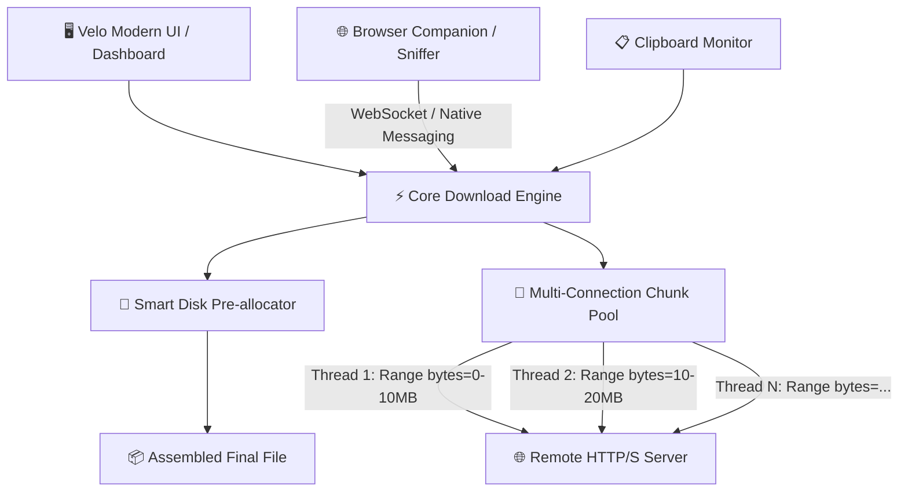

<div align="center">

# ⚡ Velo
### *Next-Gen Multi-Stream Download Accelerator*

[](LICENSE)
[]()
[]()
[]()

**Velo** is a blazingly fast, modern, and completely free & open-source download manager designed to rival and surpass legacy tools like Internet Download Manager (IDM). Built with multi-threaded connection acceleration, intelligent stream chunking, and a sleek 2027-grade desktop interface.

---

</div>

## ✨ Key Features (Roadmap)

- 🚀 **Dynamic Multi-Stream Acceleration**: Splits files into up to 32 parallel socket streams with HTTP `Range` requests, squeezing 100% of your network bandwidth.
- ⏯️ **Smart Pause & Resume**: Fault-tolerant session management. Seamlessly resume broken or interrupted downloads without losing progress.
- 📊 **Real-time Diagnostics**: Live bandwidth graphing, chunk visualization, per-connection health monitoring, and precise ETA calculations.
- 🎬 **Universal Media Sniffer**: Integrated video/audio stream parser (HLS `.m3u8`, DASH `.mpd`, direct media) for grabbing streaming media from the web.
- 🌐 **Browser Extension Integration**: Companion extension for Chrome, Edge, and Firefox to catch file links and intercept downloads automatically.
- 📋 **Clipboard Monitor**: Instant URL detection when copying file links anywhere on your OS.
- 🎛️ **Bandwidth Throttler & Scheduler**: Token-bucket speed limiting so downloads don't choke your gaming, streaming, or video calls.
- 🛡️ **Zero Bloat, Zero Ads**: 100% free, telemetry-free, ad-free, open-source forever.

---

## 🏗️ Architecture Overview



---

## 📂 Project Structure

```text
Velo/
├── src/                # Core application source code
│   ├── engine/         # Multi-threaded download engine & chunk manager
│   ├── ui/             # Modern GUI & design system
│   ├── extension/      # Browser companion sniffer
│   └── utils/          # Network, disk I/O, and format helpers
├── assets/             # Logos, icons, and interface assets
├── tests/              # Engine benchmarks and unit tests
├── .gitignore          # Repository gitignore rules
├── LICENSE             # MIT Open Source License
└── README.md           # Project documentation
```

---

## 🛠️ Getting Started

> *Detailed setup instructions and builds will be released as development progresses.*

### Prerequisites
- Modern OS: Windows 10/11, Linux, or macOS
- Git

---

## 📜 License
Distributed under the MIT License. See `LICENSE` for more information.

---

<div align="center">
Made with ❤️ by <a href="https://github.com/ahmed-el4enawy">Ahmed Elshenawy</a>
</div>