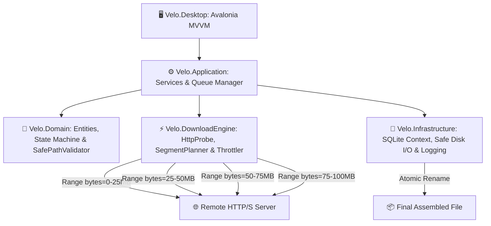

<div align="center">

# ⚡ VELO
### *Next-Gen Multi-Stream Download Accelerator*
**High-Throughput, Resilient, Zero-Cost Desktop Download Manager for Windows 10 x64**

[](LICENSE)
[](https://learn.microsoft.com/dotnet/)
[-indigo.svg)](https://avaloniaui.net/)
[-0078D6.svg)](docs/PRD.md)
[]()

**Velo** is an open-source, multi-connection download accelerator crafted strictly for **Windows 10 22H2 64-bit**. Designed to replace legacy commercial tools like Internet Download Manager (IDM), Velo offers segmented HTTP range acceleration, crash-safe state recovery, token-bucket speed throttling, and a modern Fluent dark-mode interface with **$0 budget, zero ads, zero telemetry, and zero subscriptions**.

---

</div>

## 📑 Core Documentation

- 📋 **[Product Requirements Document (PRD v2.0)](docs/PRD.md)** — Binding specification, scope, and non-negotiables.
- 🏗️ **[System Architecture](docs/ARCHITECTURE.md)** — Layer boundaries, SQLite schema, state machines, and concurrency model.
- 🛡️ **[Security & Privacy Specification](docs/SECURITY.md)** — SafePathValidator, zero telemetry, and Native Messaging isolation.
- 🧪 **[Test Plan & Verification Gate](docs/TEST_PLAN.md)** — Fixture matrix, crash recovery tests, and benchmark gates.
- 🛠️ **[Requirements & Developer Setup](REQUIREMENTS.md)** — Prerequisites, package matrix, and build instructions.
- ⚖️ **[Third-Party Notices](THIRD_PARTY_NOTICES.md)** — Open-source license compliance audit.

---

## ✨ Features at a Glance

- 🚀 **Segmented Multi-Connection Engine**: Splits files into up to 16 parallel socket streams with HTTP `Range` requests.
- ⏯️ **Transactional Crash Recovery**: Partial state and offsets are continuously checkpointed to an embedded SQLite database (`%LOCALAPPDATA%\Velo\velo.db`).
- 🛡️ **Path Traversal & Device Name Defense**: Sanitizes `Content-Disposition` against Windows DOS device names (`CON`, `PRN`, `AUX`, `NUL`) and directory traversal.
- 🎛️ **Token-Bucket Bandwidth Limiter**: Configurable speed caps without high CPU utilization.
- 🎨 **Modern Fluent UI**: Dark mode default, keyboard navigation, clean progress diagnostics, and responsive layout.
- 🌐 **Isolated Browser Companion (P1)**: Native Messaging bridge for Chrome, Edge, and Firefox without exposing private credentials.
- 📦 **Per-User Installer**: Lightweight NSIS installer that validates 64-bit architecture and Windows 10 version without requiring administrator elevation.

---

## 🏗️ Architecture Overview



---

## 📂 Repository Structure

```text
Velo/
├── Velo.sln                      # Master solution file
├── Velo.slnx                     # Modern .NET XML solution format
├── global.json                   # .NET 10 SDK rollForward configuration
├── Directory.Build.props         # Central compiler & platform settings
├── Directory.Packages.props      # Central Package Management (CPM)
├── REQUIREMENTS.md               # Developer environment setup
├── THIRD_PARTY_NOTICES.md        # Open-source license audit
├── docs/                         # PRD, Architecture, Security, Test Plan
├── src/
│   ├── Velo.Domain/              # Entities (DownloadJob, DownloadSegment, SafePathValidator)
│   ├── Velo.DownloadEngine/      # HTTP Range probe, SegmentPlanner, Throttler
│   ├── Velo.Infrastructure/      # SQLite context, disk file manager, Serilog
│   ├── Velo.Application/         # DownloadService, QueueManager, Clipboard listener
│   ├── Velo.Desktop/             # Avalonia UI Fluent Views and ViewModels
│   ├── Velo.NativeMessaging/     # Browser companion native messaging host
│   └── Velo.MediaIntegration/    # Modular external adapter boundary (P2)
├── extensions/                   # Companion browser extensions (Chromium & Firefox)
├── tests/
│   ├── Velo.UnitTests/           # Unit tests (Planner, PathValidator, State)
│   ├── Velo.IntegrationTests/    # SQLite and mock HTTP integration tests
│   └── Velo.EndToEndTests/       # UI ViewModels and queue end-to-end tests
├── packaging/                    # NSIS per-user Windows 10 x64 installer
└── scripts/                      # PowerShell build and test automation scripts
```

---

## 🚀 Quick Start

### 1. Prerequisites
- **OS:** Windows 10 version 22H2 (64-bit)
- **SDK:** [.NET 10.0 SDK](https://dotnet.microsoft.com/download/dotnet/10.0) (`winget install Microsoft.DotNet.SDK.10`)

### 2. Build & Test
```powershell
# Restore dependencies
dotnet restore

# Build solution
dotnet build Velo.sln

# Run all test suites
dotnet test Velo.sln
```

### 3. Run Velo
```powershell
dotnet run --project src/Velo.Desktop/Velo.Desktop.csproj
```

---

## 📜 License
Distributed under the **MIT License**. See [LICENSE](LICENSE) for details.

---

<div align="center">
Crafted with ❤️ by <a href="https://github.com/ahmed-el4enawy">Ahmed Elshenawy</a>
</div>