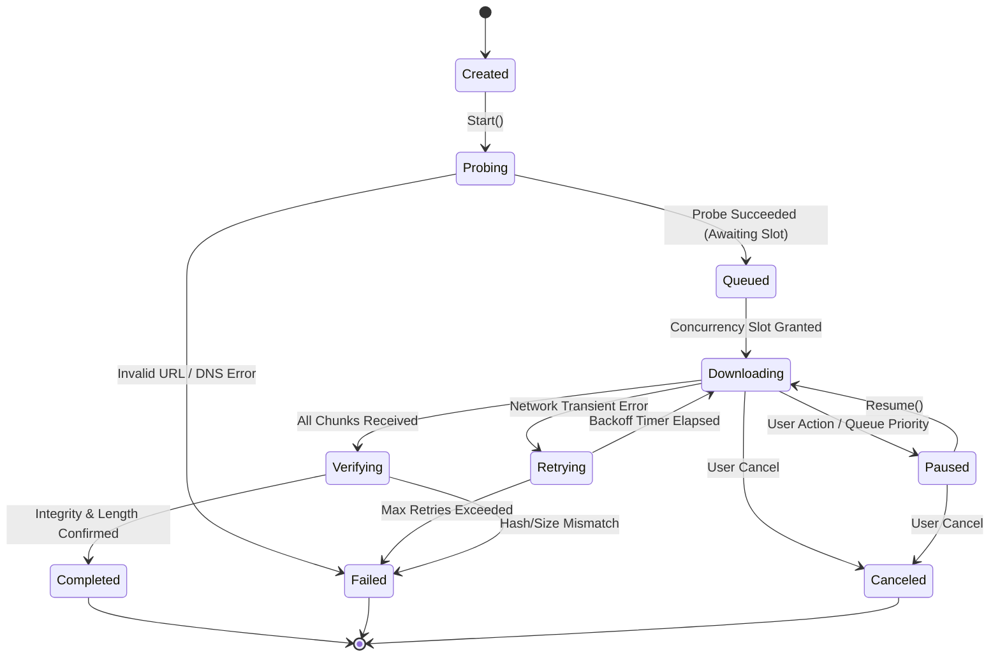

# Velo Architecture & System Design

## 1. System Philosophy & Design Principles

Velo is designed strictly for **Windows 10 22H2 x64** as a robust, resilient, multi-stream download accelerator built with **C# / .NET 10 LTS**, **Avalonia UI**, and **SQLite**.

### Key Principles:
- **Resilience Over Speed**: A fast download that is corrupt or unrecoverable is a failure. State is checkpointed transactionally in SQLite.
- **Strict Layer Separation**: UI controls must never block transfer worker threads. No network logic exists inside ViewModels.
- **Dependency Inversion**: Application services interact with interfaces (`IDownloadEngine`, `IDownloadRepository`, `IFileManager`, `ISpeedThrottler`).
- **Bounded Concurrency**: Sockets, memory buffers, and disk threads are strictly capped to prevent socket exhaustion and memory bloat.

---

## 2. Layered Architecture

```text
┌──────────────────────────────────────────────────────────────────┐
│                   Velo.Desktop (Avalonia MVVM)                  │
│       Views (XAML), ViewModels, Converters, Fluent Theme        │
└─────────────────────────────────┬────────────────────────────────┘
                                  │ Commands & ViewState
                                  ▼
┌──────────────────────────────────────────────────────────────────┐
│                         Velo.Application                         │
│  Orchestration, Queue Management, Throttling, Clipboard Monitor  │
└───────────────┬──────────────────────────────────┬───────────────┘
                │ Domain Events                    │ Interfaces
                ▼                                  ▼
┌──────────────────────────────────┐ ┌─────────────────────────────┐
│           Velo.Domain            │ │     Velo.DownloadEngine     │
│ Entities: Job, Segment, State    │ │ HttpProbe, SegmentWorker    │
│ Value Objects: ByteRange, Speed  │ │ TokenBucket, BackoffRetry   │
└──────────────────────────────────┘ └─────────────┬───────────────┘
                                                   │
                                                   ▼
┌──────────────────────────────────────────────────────────────────┐
│                       Velo.Infrastructure                        │
│   SQLite Persistence, Safe File I/O (.velo.part), Logging, System│
└──────────────────────────────────────────────────────────────────┘
```

---

## 3. Project Boundaries & Responsibilities

| Project | Responsibility | Dependencies |
| :--- | :--- | :--- |
| **`Velo.Domain`** | Pure business entities (`DownloadJob`, `DownloadSegment`, `JobState`, `JobPriority`, `HashVerification`), invariants, and domain events. Zero external dependencies. | None |
| **`Velo.DownloadEngine`** | HTTP probing (`HEAD` + `GET Range: bytes=0-0`), segmented range streaming, token-bucket throttling, adaptive exponential backoff. | `Velo.Domain` |
| **`Velo.Infrastructure`** | SQLite database context (`Microsoft.Data.Sqlite`), schema migrations, atomic file renaming, `.velo.part` pre-allocation, structured Serilog logging. | `Velo.Domain`, `Microsoft.Data.Sqlite` |
| **`Velo.Application`** | Queue scheduling, active job limits, concurrency balancing, clipboard URL listener, integration contracts. | `Velo.Domain`, `Velo.DownloadEngine`, `Velo.Infrastructure` |
| **`Velo.Desktop`** | Avalonia UI desktop frontend, responsive Fluent Dark/Light theme, reactive ViewModels (`CommunityToolkit.Mvvm`), visual download cards, speed charts. | `Velo.Application`, `Avalonia`, `CommunityToolkit.Mvvm` |
| **`Velo.NativeMessaging`** | Isolated console application acting as Chrome/Edge/Firefox Native Messaging host. Validates extension origin and safely dispatches jobs to Velo. | `Velo.Domain`, `Velo.Application` |
| **`Velo.MediaIntegration`**| Optional boundary adapter for external media extraction (`yt-dlp` / `FFmpeg`) strictly decoupled from the core engine. | `Velo.Domain` |

---

## 4. Download State Machine



---

## 5. Persistence Schema (SQLite)

Located at `%LOCALAPPDATA%\Velo\velo.db`:

- **`downloads`**: Primary metadata, source URL, target path, file size, ETag, Last-Modified, state, checksum.
- **`segments`**: Individual byte ranges (`[start_byte, end_byte]`), `next_byte` offset, retry count, status.
- **`settings`**: Key-value application configurations (concurrency, speed cap, dark mode, default directory).
- **`diagnostic_events`**: Bounded local error log (strictly redacting auth headers, tokens, and cookies).

---

## 6. Threading & Concurrency Contract

- **UI Thread**: Exclusively handles Avalonia UI rendering and user interactions. Dispatches observable property changes.
- **Engine Worker Pool**: Asynchronous tasks executing on the .NET `ThreadPool`.
- **I/O Operations**: Exclusively asynchronous `FileStream` and `HttpClient` calls with cooperative `CancellationToken`.
- **Throttling**: Centralized `TokenBucket` rate limiter across all active segments to enforce aggregate bandwidth caps without burning CPU.
